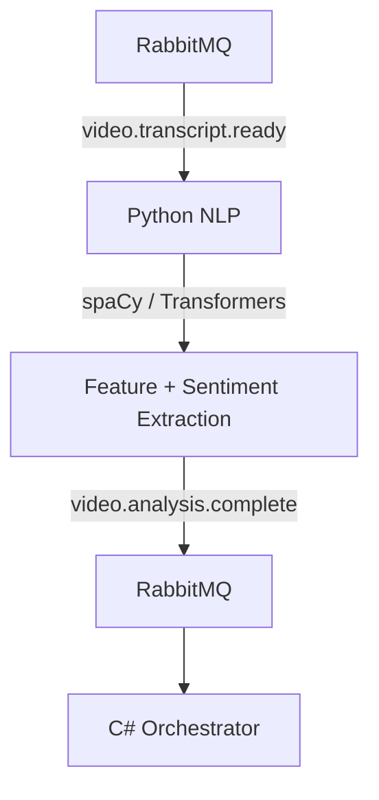

# 🐍 Sentimentator: – Python NLP & Sentiment Analysis Service

### Consumes Transcripts and Publishes Sentiment Results

## 🎯 Purpose

Processes textual transcripts to:

-   Detect smartphone-related features (e.g., camera, battery, display).
-   Evaluate sentiment (positive, negative, neutral) for each feature.
-   Compute overall sentiment summary.

## 🧱 Workflow

1. Consume `video.transcript.ready` event.
2. Extract device features using NLP .
3. Analyze sentiment per sentence or feature using transformers.
4. Summarize results (overall + per feature).
5. Publish `video.analysis.complete` event with structured sentiment data.

## 🧩 Service Flow

🛠️ Technologies
TODO
