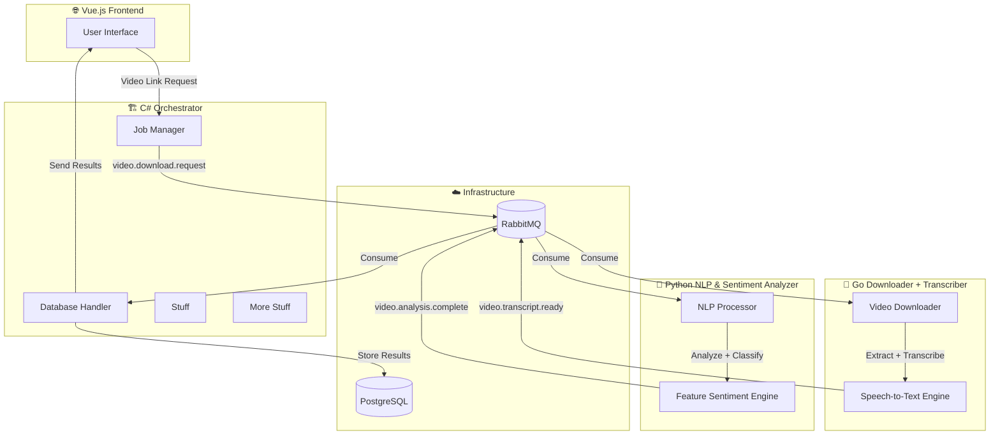
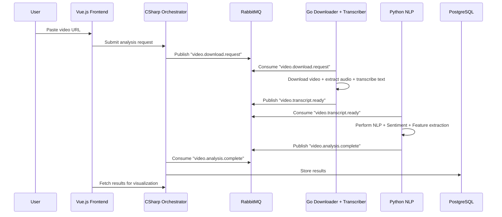

# 🎥 Sentimentator - Review Sentiment Analyzer

## 🧠 Overview

**Sentimentator** is a distributed, event-driven system that automatically analyzes **video reviews** of smartphones (from YouTube, ~~TikTok~~, and ~~Instagram~~) and produces a **synthetic sentiment summary** of opinions about device features (e.g., camera, battery, screen, performance).

## 🌍 High-Level Architecture

# System Flow Overview

## 📨 RabbitMQ Event Model

| Event                     | Producer | Consumer | Description                                |
| ------------------------- | -------- | -------- | ------------------------------------------ |
| `video.download.request`  | C#       | Go       | Request to fetch & transcribe video        |
| `video.transcript.ready`  | Go       | Python   | Transcript ready for NLP                   |
| `video.analysis.complete` | Python   | C#       | Final sentiment analysis ready for storage |
