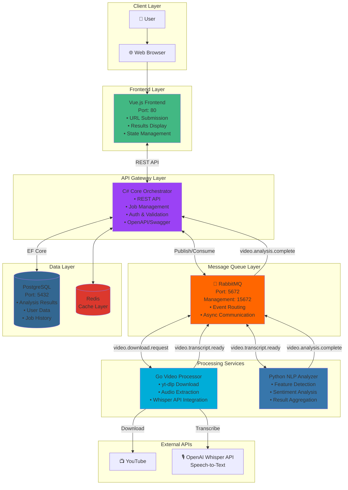
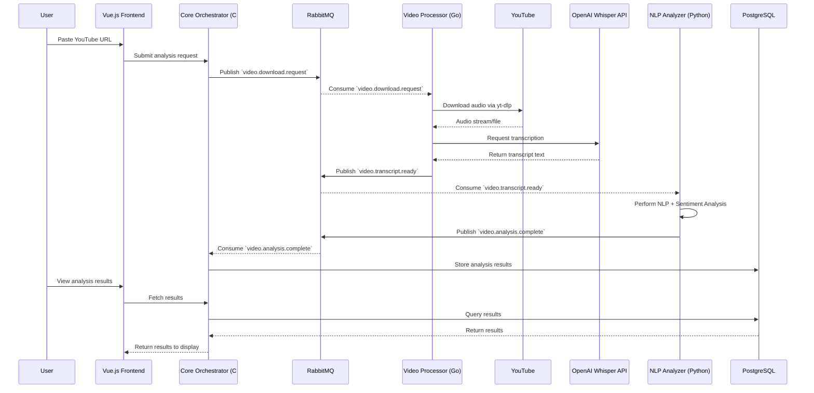
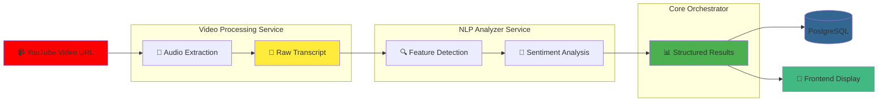

# 🎥 Sentimentator - Review Sentiment Analyzer

## 🧠 Overview

**Sentimentator** is a distributed, event-driven system that automatically analyzes **video reviews** of smartphones from **YouTube** and produces a **synthetic sentiment summary** of opinions about device features (e.g., camera, battery, screen, performance).

## 🌍 High-Level Architecture

The system is composed of several microservices that communicate asynchronously via a message queue.

## 📈 System Flow Overview

This sequence diagram illustrates the detailed, step-by-step flow of a request through the system.

## 📨 RabbitMQ Event Model

| Event                     | Producer | Consumer | Description                                |
| ------------------------- | -------- | -------- | ------------------------------------------ |
| `video.transcript.requested`  | C#       | Go       | Request to fetch & transcribe video        |
| `video.transcript.completed`  | Go       | Python   | Transcript ready for NLP                   |
| `video.analysis.completed` | Python   | C#       | Final sentiment analysis ready for storage |

## 🔄 Data Flow Diagram

This diagram illustrates the data transformation pipeline:

## 📊 Technology Stack Overview

| Layer                | Technologies                                          |
| -------------------- | ----------------------------------------------------- |
| **Frontend**         | Vue.js 3, Vite, Tailwind CSS v4, Pinia, Fetch API     |
| **Backend API**      | C#, ASP.NET Core, Entity Framework Core               |
| **Video Processing** | Go, Gin Framework, yt-dlp, FFmpeg, OpenAI Whisper API |
| **NLP & ML**         | Python                                                |
| **Message Queue**    | RabbitMQ 4.1.4 with Management Plugin                 |
| **Databases**        | PostgreSQL 18, Redis (planned)                        |
| **DevOps**           | Docker, Docker Compose                                |
| **External APIs**    | YouTube (via yt-dlp), OpenAI Whisper API              |

## 🤝 Contributing

Each service has its own README with detailed information:

- [Frontend Development](./core_frontend/README.md)
- [Backend Orchestrator](./core_orchestrator/README.md)
- [Video Processing](./video_processing_service/README.md)
- [NLP Analyzer](./NLP_analyzer_service/README.md)

## 📄 License

TBD
