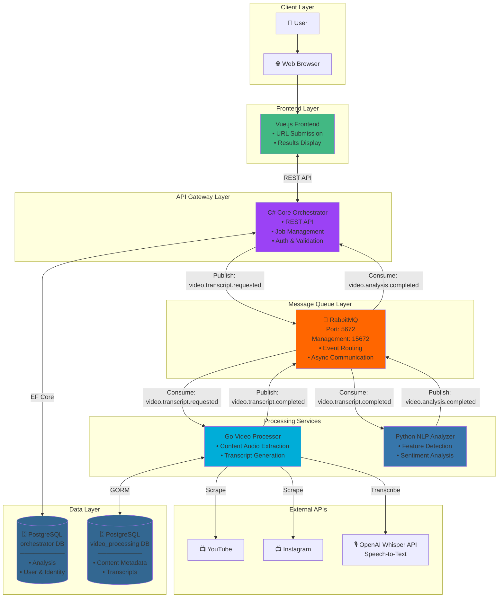
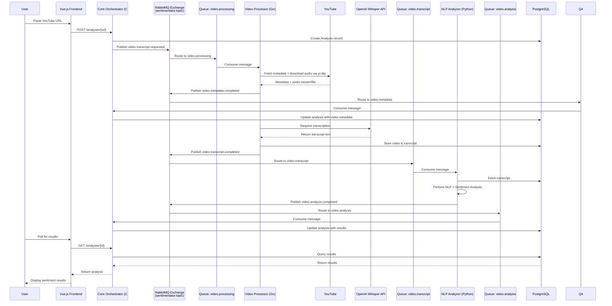
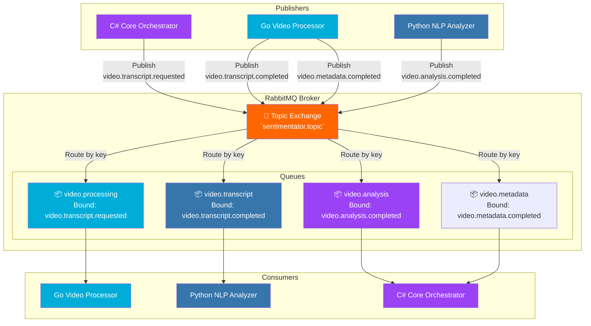
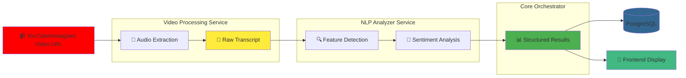

# 🎥 Sentimentator - Review Sentiment Analyzer

## 🧠 Overview

**Sentimentator** is a distributed, event-driven system that automatically analyzes **video reviews** of smartphones from **YouTube** and produces a **synthetic sentiment summary** of opinions about device features (e.g., camera, battery, screen, performance).

## 🌍 High-Level Architecture

The system is composed of several microservices that communicate asynchronously via a message queue.

## 📈 System Flow Overview

This sequence diagram illustrates the detailed, step-by-step flow of a request through the system.

## 📨 RabbitMQ Event Architecture

This diagram shows the detailed RabbitMQ topology with exchanges, queues, routing keys, and event flows:

### Event Details

| Event Name               | Routing Key                  | Publisher           | Queue              | Consumer            | Payload                                                                        |
| ------------------------ | ---------------------------- | ------------------- | ------------------ | ------------------- | ------------------------------------------------------------------------------ |
| **Transcript Requested** | `video.transcript.requested` | C# Orchestrator     | `video.processing` | Go Video Processor  | `{analysis_id, url, timestamp}`                                                |
| **Transcript Completed** | `video.transcript.completed` | Go Video Processor  | `video.transcript` | Python NLP Analyzer | `{analysis_id, video_id, transcript_id, text, language, duration, created_at}` |
| **Analysis Completed**   | `video.analysis.completed`   | Python NLP Analyzer | `video.analysis`   | C# Orchestrator     | `???`                                                                          |
| **Metadata Completed**   | `video.metadata.completed`   | Go Video Processor  | `video.metadata`   | C# Orchestrator     | `{analysis_id, video_id, title, thumbnail_url, duration_seconds?, ???}`        |

## 🔄 Data Flow Diagram

This diagram illustrates the data transformation pipeline:

## 📊 Technology Stack Overview

| Layer                | Technologies                                          |
| -------------------- | ----------------------------------------------------- |
| **Frontend**         | Vue.js 3, Vite, Tailwind CSS v4, Pinia, OpenAPI/fetch |
| **Backend API**      | C#, ASP.NET Core, Entity Framework Core               |
| **Video Processing** | Go, Gin, yt-dlp, FFmpeg, OpenAI Whisper API           |
| **NLP & ML**         | Python ???                                            |
| **Message Queue**    | RabbitMQ 4.1.4 with Management Plugin                 |
| **Databases**        | PostgreSQL 18                                         |
| **DevOps**           | Docker, Docker Compose                                |
| **External APIs**    | YouTube & Instagram (via yt-dlp), OpenAI Whisper API  |

## 🤝 Contributing

Each service has its own README with detailed information:

-   [Frontend Development](./core_frontend/README.md)
-   [Backend Orchestrator](./core_orchestrator/README.md)
-   [Video Processing](./video_processing_service/README.md)
-   [NLP Analyzer](./NLP_analyzer_service/README.md)

## 📄 License

TBD
