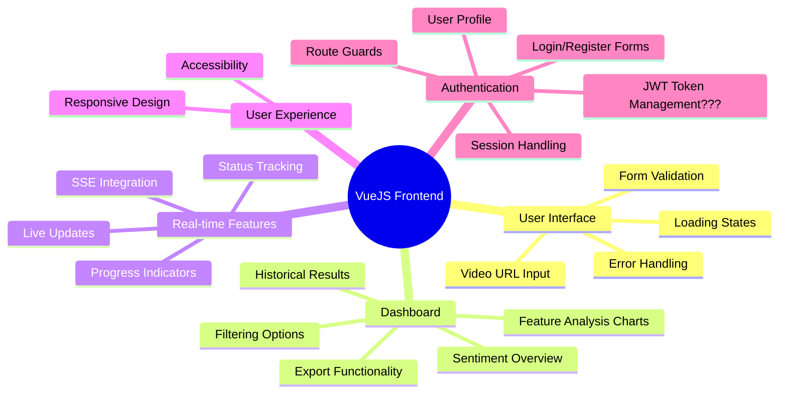

# Sentimentator: Vue.Js Frontend Application

### UI for Submitting Links and Viewing Sentiment Results

### **Feature Responsibilities**

## 🛠️ Technology Stack

| Component            | Technology               |
| -------------------- | ------------------------ |
| **Framework**        | Vue.Js (Composition API) |
| **Styling**          | Tailwind CSS v4          |
| **Charts**           | ???                      |
| **State Management** | Pinia                    |
| **HTTP**             | Fetch API                |
| **Testing**          | xD Vitest+Cypress???     |
| **Bundler**          | Vite                     |
