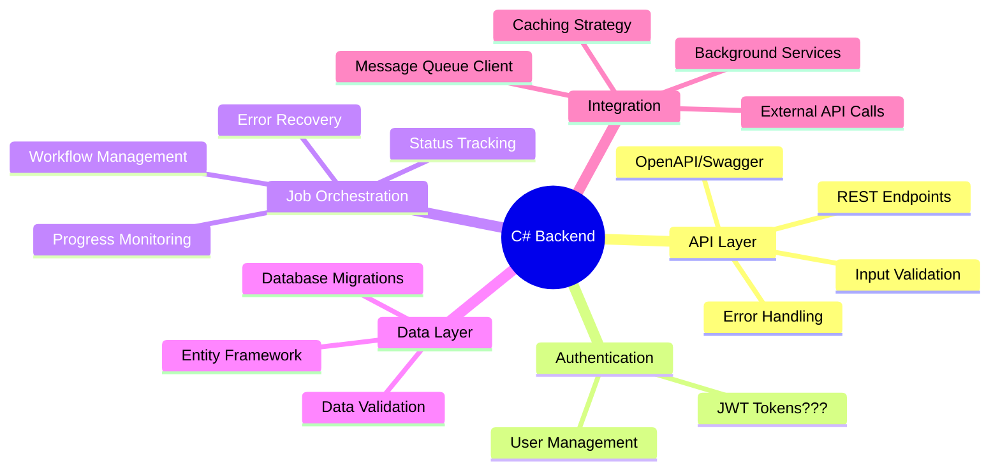
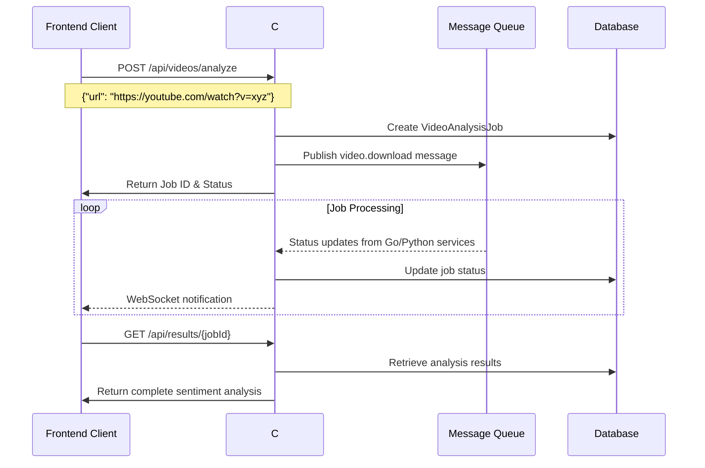
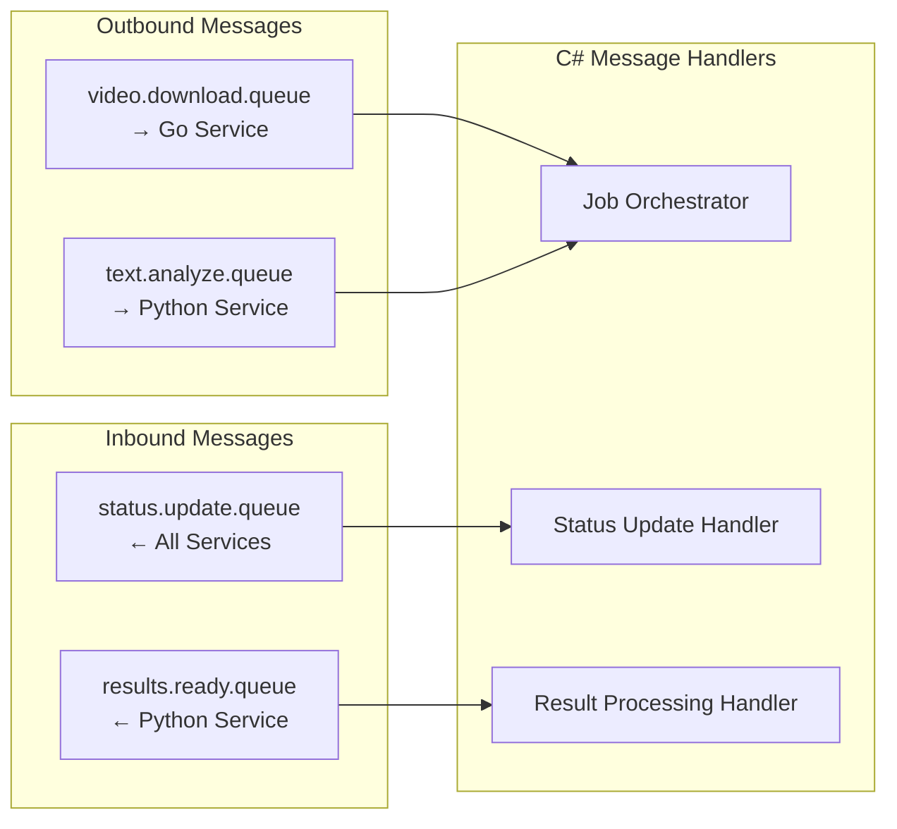

# Sentimentator: C# Backend Orchestrator Service

## 🎯 Purpose

Central service responsible for:

-   Accepting frontend requests to analyze videos.
-   Publishing jobs to RabbitMQ (`video.download.request`).
-   Listening for analysis results (`video.analysis.complete`).
-   Storing and serving results from PostgreSQL.
-   ~~Notifying frontend (via server-sent events) when analysis is available.~~

---

### **Key Deliverables**

## 🛠️ Technology Stack

| Component         | Technology          | Purpose                     |
| ----------------- | ------------------- | --------------------------- |
| **Framework**     | ???                 | Web API framework           |
| **Database**      | ???                 | Data persistence            |
| **Cache**         | Redis               | Performance optimization    |
| **Queue**         | RabbitMQ            | Inter-service communication |
| **Auth**          | JWT Bearer          | Authentication              |
| **Documentation** | Swagger/OpenAPI ??? | API documentation           |
| **Testing**       | xD                  | Unit/Integration tests      |
| **Monitoring**    | ???                 | Logging and monitoring      |

