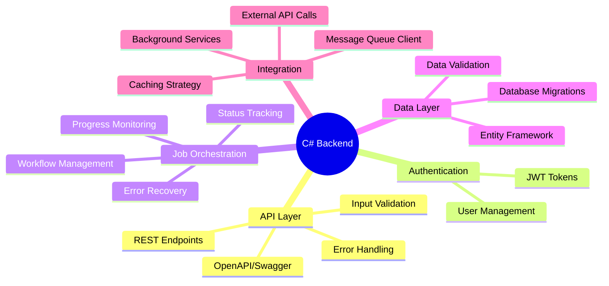

# Sentimentator: C# Backend Orchestrator Service

## 🎯 Purpose

Central service responsible for:

-   Provide REST endpoints .
-   Publish `video.download.request` messages for the downloader service.
-   Consume `video.metadata.complete` messages and persist video metadata.
-   Consume `video.analysis.complete` messages and persist final structured results.
-   Storing and serving results from PostgreSQL.
-   ~~Notifying frontend (via server-sent events) when analysis is available.~~

---

### **Key Deliverables**

## 🛠️ Technology Stack

| Component         | Technology         | Purpose                     |
| ----------------- |--------------------| --------------------------- |
| **Framework**     | ASP.NET            | Web API framework           |
| **Database**      | PostgreSQL         | Data persistence            |
| **Queue**         | RabbitMQ           | Inter-service communication |
| **Auth**          | Bearer Tokens      | Authentication              |
| **Documentation** | OpenAPI            | API documentation           |
| **Testing**       | xUnit              | Unit/Integration tests      |
| **Monitoring**    | C# built-in Logger | Logging and monitoring      |

## Analysis Role Workflow (CanRequestAnalysis)

### Adding role

#### By adding OpenAI key

- Add a key using the `/users/openai-api-key` POST endpoint
- User is added to role
- Use `/account/login` or `/account/refresh` endpoint to get new token
- `/analyses` POST endpoint will now be available

#### By using the admin user

- Log in as the admin user
- Use `/admin/role` POST endpoint to add user to role
- Log in as target user

### Removing role

#### By removing OpenAI key

- Remove the key using the `/users/openai-api-key` DELETE endpoint
- User is removed from role
- Use `/account/login` or `/account/refresh` endpoint to get new token

#### By using the admin user

- Log in as the admin user
- Use `/admin/role` DELETE endpoint to remove user from role
- Log in as target user