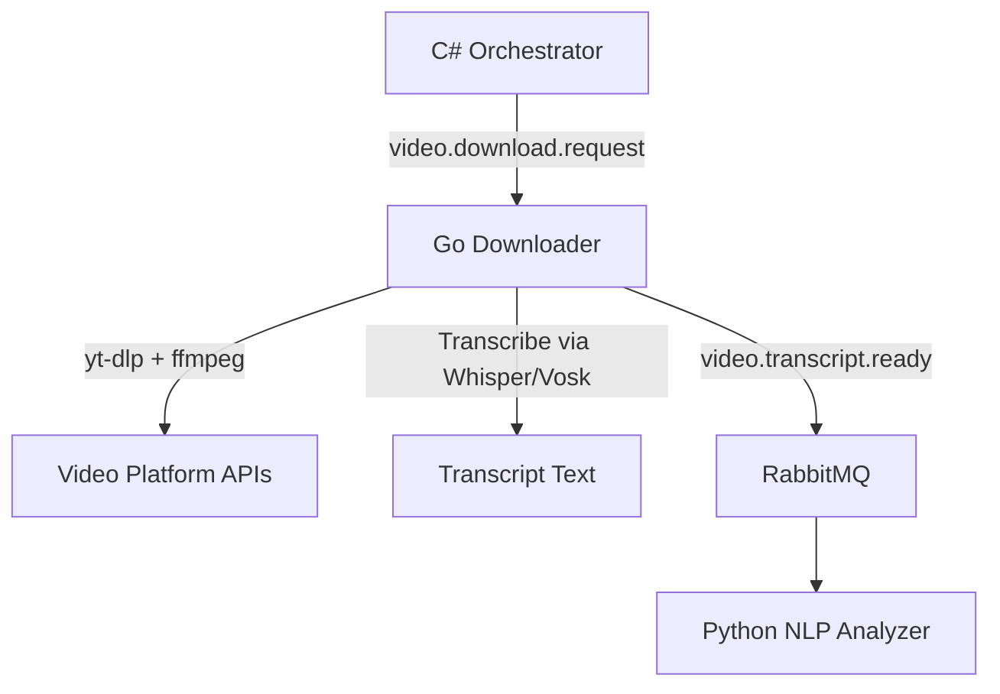
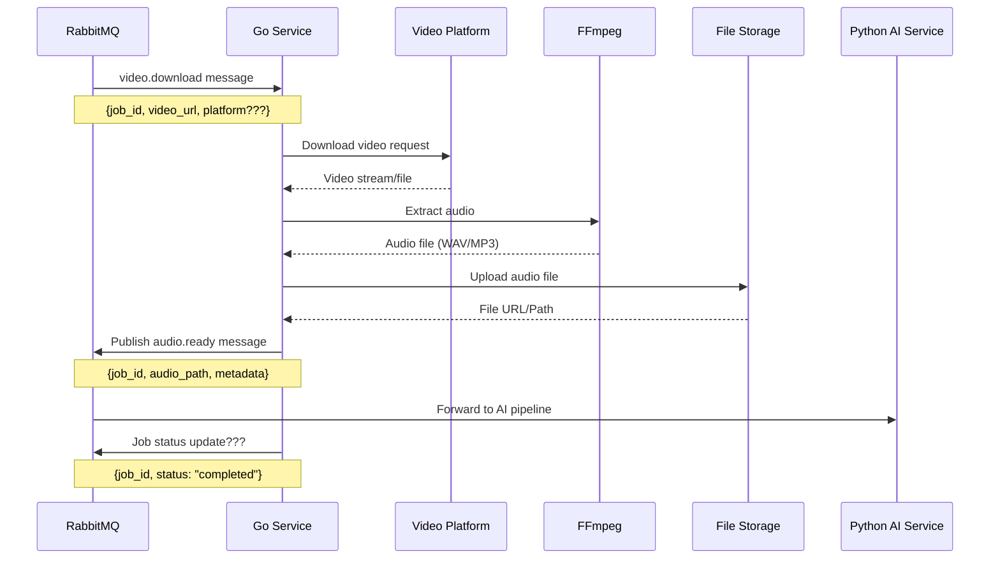

# Sentimentator: Go Media Retrieval & Audio & Transcription Service

### Consumes Download Requests and Publishes Transcripts

## 🎯 Purpose

Handles:

-   Video/audio downloading from YouTube, TikTok, and Instagram.
-   Audio extraction.
-   Speech-to-text transcription (using Whisper or Vosk).
-   Publishing transcripts for further NLP analysis.

## 🧱 Workflow

1. Consume `video.download.request` event.
2. Download video via `yt-dlp` (detect platform automatically).
3. Extract `.wav` audio using `ffmpeg`.
4. Transcribe audio to text with a speech-to-text model (Whisper/Vosk).
5. Publish a `video.transcript.ready` event containing the transcript and metadata.

## 🧩 Event Flow

## 🛠️ Technology Stack

| Component        | Technology                 | Purpose                |
| ---------------- | -------------------------- | ---------------------- |
| Framework        | Gin                        | Web server             |
| Video Processing | yt-dlp + go-ytdlp + FFmpeg | Video/audio extraction |
| Storage          | Local                      | Storage integration    |
| Queue            | amqp (RabbitMQ)            | Message queue client   |
| Scraping         | Colly                      | Web scraping framework |
| Logging          | Logrus                     | Structured logging     |
| Monitoring       | Prometheus + pprof (maybe) | Performance monitoring |

## 🔄 Processing Workflow

