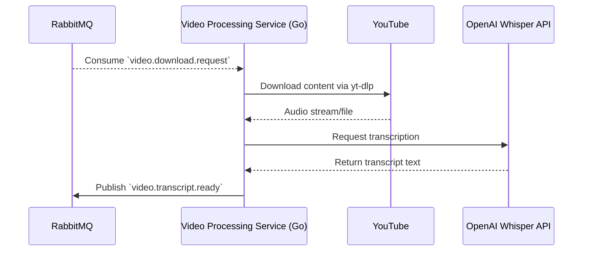

# Sentimentator: Video URL Processing Service (Go)

### Consumes Download Requests and Publishes Transcripts

## 🎯 Purpose

This service is responsible for processing video content in such a way to extract its transcript.

-   Downloading video/audio from **YouTube**.
-   Extracting audio from the downloaded files.
-   Transcribing the audio to text using the **OpenAI Whisper API**.
-   Publishing the resulting transcripts for downstream analysis by the NLP service.

## 🧱 Workflow

1.  **Consume** a `video.download.request` event from the message queue. The event contains the URL of content.
2.  **Download** the audio from the provided URL or video.
3.  **Transformation** ensure possession of audio format suitable for the transcription service (`.mp3`).
4.  **Transcribe** the audio to text by calling the **OpenAI Whisper API**.
5.  **Publish** a `video.transcript.ready` event to the message queue, containing the transcript text and associated metadata.

## 🧩 Event Flow

Here is a sequence diagram illustrating the interaction between the services:

## 🛠️ Technology Stack

| Component              | Technology                | Purpose & Justification                                                                                                            |
| ---------------------- | ------------------------- | ---------------------------------------------------------------------------------------------------------------------------------- |
| Web Framework          | Gin                       | Minimalistic and fast web framework allowing for dev-debugging features.                                                           |
| Video/Audio Processing | yt-dlp / go-ytdlp         | Tool for downloading video and audio from various platforms, including YouTube.                                                    |
| Audio Extraction       | FFmpeg                    | Used here to extract audio streams from video files if download of `.mp3` won't be available.                                      |
| Transcription          | OpenAI Whisper API        | Chosen based on research indicating better transcription quality, simpler implementation compared to alternatives like Google STT. |
| Message Queue          | RabbitMQ (via amqp091-go) | A mature message broker for asynchronous communication between services with built-in retry logic.                                 |
| Database               | PostgreSQL + GORM         | Reliable relational database with ORM for job queue and video metadata storage.                                                    |
| Logging                | `log/slog`                | Standard Go structured logging library.                                                                                            |

## 🎨 Debug Interface

The service includes a web-based debug interface for development and testing.

### Main Dashboard

-   **URL**: http://localhost:8080/web/
-   Submit YouTube videos for processing
-   View job statistics (updated every 5s)
-   List processed videos

### Event Emulator

-   **URL**: http://localhost:8080/web/debug/events
-   Manually trigger RabbitMQ events for testing
-   Test event types:
    -   **video.received**: Simulate new video submission
    -   **transcript.ready**: Simulate completed transcription
    -   **processing.failed**: Test error handling
